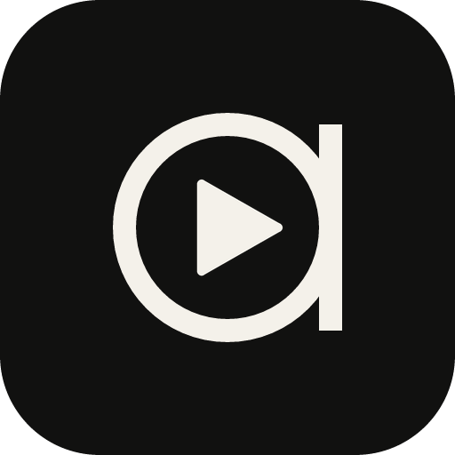

<p align="center">
  
</p>

<h1 align="center">Atic-play</h1>

<p align="center">
  Un reproductor de escritorio para YouTube Music, nativo y liviano.<br>
  Rust + <a href="https://gpui.rs">GPUI</a>, con Material 3 Expressive.
</p>

Atic-play reproduce tu YouTube Music sin navegador: tu biblioteca, tus playlists
y tus me gusta, con letras sincronizadas, sin cortes entre canciones y con los
colores de la portada que suena. Es compañero de [Atic](https://github.com/chrx3/atic):
su pill muestra lo que suena en Atic-play y lo controla.

> Proyecto personal, no afiliado a Google ni a YouTube. Usa tu propia cuenta.

## Qué hace

| | |
|---|---|
| **Escuchar** | Búsqueda con sugerencias, inicio con tendencias y novedades, álbumes, artistas y **Explorar** por estados de ánimo y géneros. |
| **Tu cuenta** | Inicia sesión con Google: biblioteca completa, me gusta, crear, renombrar y borrar playlists y guardar canciones en ellas. |
| **Reproducción** | Sin pausas o con fundido entre canciones, volumen normalizado, radio automática al final de la cola, aleatorio y repetir. |
| **Cola** | Reproducir a continuación, agregar, quitar y vaciar. |
| **Letras** | Sincronizadas, desde [LRCLIB](https://lrclib.net). |
| **Sin conexión** | Descarga canciones y playlists; lo que escuchas queda en un caché en disco. |
| **Historial** | Lo que escuchaste en este equipo, por día. |
| **Escritorio** | Teclas multimedia y "Ahora suena" de Windows, atajos de teclado (Ajustes los lista), y si cambias la salida de audio la música sigue en el nuevo dispositivo (al desconectar los audífonos queda en pausa). |
| **Interfaz** | Material 3 Expressive con [gpui-m3](https://github.com/chrx3/gpui-m3): colores tomados de la portada, formas que se transforman, movimiento con resortes. |

## Requisitos

- **Windows 10/11.** El soporte para **macOS** está en camino.
- [**yt-dlp**](https://github.com/yt-dlp/yt-dlp) en el `PATH` (o la ruta en la
  variable `YT_DLP`). Atic-play lo usa para obtener el audio.
- [**Node.js**](https://nodejs.org) en el `PATH`: yt-dlp lo necesita para el
  desafío de JavaScript de YouTube con la sesión iniciada.
- Una cuenta de YouTube Music. Con **Premium** el audio llega a 256 kbps.

## Compilar

```bash
git clone https://github.com/chrx3/atic-play
cd atic-play
cargo run --release -p ytm-desktop
```

La primera compilación tarda varios minutos (GPUI es grande). La versión de
desarrollo (`cargo run -p ytm-desktop`) ya optimiza las dependencias.

Para trabajar en gpui-m3 al mismo tiempo, apúntalo a una copia local en
`.cargo/config.toml` (no se sube):

```toml
[patch."https://github.com/chrx3/gpui-m3"]
gpui-m3 = { path = "../gpui-m3" }
```

`RUST_LOG` controla lo que se ve en la consola (por omisión, la información de
la app y las advertencias del resto).

## Cómo está hecho

| Ruta | Qué hay |
|---|---|
| `crates/core` | YouTube Music (búsqueda, biblioteca, playlists, radio), descarga y caché del audio, reproductor con dos bandejas (sin pausas y fundido), normalización, letras. Sin interfaz. |
| `crates/desktop` | La app GPUI: vistas, barra del reproductor, sesión multimedia del sistema, inicio de sesión con Google. |
| `vendor/rustypipe` | [RustyPipe](https://codeberg.org/ThetaDev/rustypipe) 0.11.4 con un arreglo: entiende la cabecera que YouTube Music manda para las playlists propias. |
| `docs/` | Planes, como la [integración con Atic](docs/atic-integration.md). |

- **Metadatos** (búsqueda, biblioteca, páginas): RustyPipe, que habla con la
  API interna de YouTube Music.
- **Audio**: yt-dlp resuelve la URL del stream (M4A/AAC); Atic-play lo descarga
  por partes, lo guarda en caché y lo reproduce con
  [rodio](https://github.com/RustAudio/rodio). Al dejar el puntero sobre una
  canción ya se empieza a resolver, para que suene antes.
- **Sesión**: el inicio de sesión abre una ventana WebView2 con un perfil propio
  y guarda las cookies de la sesión en la carpeta de datos de la app
  (`%APPDATA%\atic-play`). No salen de tu equipo salvo hacia YouTube.

## Datos y privacidad

- Todo queda en tu equipo: la sesión, el caché de audio, las descargas y el
  historial.
- Las letras se piden a LRCLIB con el título, el artista y la duración.
- No hay telemetría.

## Licencia

[GPL-3.0-or-later](LICENSE). Incluye RustyPipe modificado (GPL-3.0) en
`vendor/rustypipe`.
